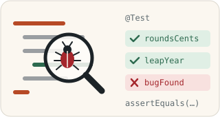

> [!NOTE]
> The English translation for this exercise can be found in [this file](./readme.en.md).

# Yksikkötestaus JUnit-työkalulla



Tämä repositorio sisältää Java-harjoituksia, joiden avulla harjoittelet yksikkötestausta [JUnit-työkalulla](https://junit.org). Aiemmista tehtävistä poiketen tässä tehtävässä ei ole valmiita testejä, vaan kirjoitat testit itse. Testattavat Java-luokat ovat valmiina projektipohjassa.

## Tehtävän aloittaminen

Forkkaa ensin tämä repositorio omaan GitHub-repositorioosi GitHubin **Fork**-painikkeella ja kloonaa vasta sitten oma forkkisi koneellesi:

```sh
git clone https://github.com/<oma-github-tunnuksesi>/4-junit-exercise.git
```

Avaa kloonattu projekti koodieditorissasi.

## Testaaminen

Voit ajaa kirjoittamiasi testejä koodieditorisi testaustyökalulla ([VS Code](https://code.visualstudio.com/docs/java/java-testing), [Eclipse](https://www.vogella.com/tutorials/JUnitEclipse/article.html)) tai [Gradlella](https://docs.gradle.org/current/userguide/java_testing.html), esimerkiksi:

```
./gradlew test --tests PriceFormatterTest       # unix
.\gradlew.bat test --tests PriceFormatterTest   # windows
```

Lisää komennon loppuun `--info`, jos haluat tarkemmat tiedot epäonnistuneista testeistä. Älä muuta testattavien metodien nimiä, parametreja tai paluuarvojen tyyppejä. Saat tiedoston alkuperäisen version takaisin komennolla `git restore <tiedoston polku>` tai kurssijärjestelmän **Palauta lähtökoodi** -toiminnolla.

## Palauttaminen ja pisteet

Jokaisella tehtävän osalla on kurssijärjestelmässä (https://jtjuslin.kapsi.fi/java) oma sivunsa, jonka koodikentissä on osan koodipohja. Kopioi ratkaisusi koodikenttiin tai kirjoita se suoraan niihin. **Testaa ilman palautusta** ajaa osan testit tallentamatta pisteitä, ja **Lähetä** palauttaa ratkaisun. Jokainen testiluokka hyväksytään vain, jos sen kaikki testit menevät läpi, ja pisteet jaetaan hyväksyttyjen testiluokkien mukaan.

**Pisteet kahdessa vaiheessa**

1. Kun ratkaisusi menee läpi kurssijärjestelmässä, saat osasta **puolet pisteistä**.
2. Pushaa lopuksi kaikki julkiseen GitHub-repositorioosi. Paina tämän jälkeen osan sivulla **Lähetä tarkistettavaksi** -nappia. Kun testit menevät läpi, saat osasta **täydet pisteet**. Repositorio saa jäädä julkiseksi.

GitHubissa ei ole arvioivaa YAML-tehtävävirtaa (GitHub Actions -workflowta), eikä `git push` käynnistä arviointia. Kun painat **Lähetä tarkistettavaksi**, kurssijärjestelmän botti hakee koodisi repositoriostasi ja tarkistaa sen samoilla testeillä. Molemmat vaiheet pitää tehdä ennen luvun määräaikaa. Voit lähettää ratkaisusi niin monta kertaa kuin tarvitset, ja voimaan jää paras tulos.


## Tehtävä 1: PriceFormatterTest *(5 * 10 %)*

Kirjoita yksikkötestejä valmiin [PriceFormatter](./src/main/java/price/formatter/PriceFormatter.java)-luokan `formatPrice`-metodille. Metodi saa parametrinaan liukuluvun ja palauttaa sen merkkijonoksi muotoiltuna:

```java
PriceFormatter formatter = new PriceFormatter();
String price = formatter.formatPrice(3.141592653589793); // palauttaa "3,14 €"
```

Perustapauksessa metodi muotoilee liukuluvun muotoon `"123 456,79 €"` seuraavien sääntöjen mukaan:

* Tuhaterottimena on välilyönti.
* Desimaalierottimena on pilkku.
* Desimaaliosa on kahden numeron pituinen ja pyöristetään lähimpään sadasosaan eli senttiin ([lisävinkki](./rounding.md)).
* Jos desimaaliosa on pyöristyksen jälkeen nolla, desimaaliosa jätetään kokonaan pois.
* Hinnan lopussa on euromerkki `€`.

**Metodia ei tarvitse toteuttaa itse**, vaan harjoittelet valmiin metodin *testaamista*. ⛔ *`PriceFormatter`-luokkaa ei saa muuttaa.*

Kirjoita testit tehtäväpohjan [PriceFormatterTest](./src/test/java/price/formatter/PriceFormatterTest.java)-luokkaan ja poista sen valmis `fail`-testi. Kirjoita jokaiselle säännölle oma testimetodi, joka kutsuu `formatPrice`-metodia eri parametreilla ja tarkistaa palautetut arvot. Metodin lähdekoodiin ei tarvitse perehtyä: tärkeintä on tuntea yllä esitetyt **vaatimukset**. Testiesi pitää mennä läpi, koska annetussa metodissa ei *pitäisi* olla virheitä.

💡 *Jos käytät testeissä lukuja, jotka ovat tasan sadasosien puolivälissä, saatat törmätä liukulukujen rajallisen tarkkuuden ongelmiin. Ongelma ei johdu Javasta eikä koodista vaan siitä, miten tietokoneet käsittelevät desimaaliosia. Tarkempi selitys on tiedostossa [rounding.md](./rounding.md) ja artikkelissa ["What Every Computer Scientist Should Know About Floating-Point Arithmetic" (oracle.com)](https://docs.oracle.com/cd/E19957-01/806-3568/ncg_goldberg.html).*

### Arviointi: mutaatiotestaus

Läpi menevät testit eivät vielä takaa, että testit ovat kattavat. Siksi kurssijärjestelmä ajaa testisi ensin toimivaa `PriceFormatter`-luokkaa vastaan, jolloin niiden kaikkien pitää mennä läpi. Sen jälkeen testisi ajetaan **viittä eri tavoin bugista versiota vastaan** 😈. Jokaisesta bugisesta versiosta saat pisteen, jos vähintään yksi testisi epäonnistuu sitä vastaan eli testisi löytävät bugin. Jos testisi eivät löydä kaikkia bugeja, varmista, että ne tarkistavat kaikki yllä esitetyt säännöt eri syötteillä.

🚀 *Tätä menetelmää kutsutaan mutaatiotestaukseksi: "Mutation testing is used to design new software tests and evaluate the quality of existing software tests. Mutation testing involves modifying a program in small ways." [(Wikipedia)](https://en.wikipedia.org/wiki/Mutation_testing)*


## Tehtävä 2: DayOfYear *(soveltava, 25 % + 25 %)*

Valmiin [DayOfYear](./src/main/java/refactoring/DayOfYear.java)-luokan staattinen metodi `dayOfYear` saa päivämäärän kolmena kokonaislukuna ja palauttaa päivän järjestysnumeron kyseisenä vuonna (1–366). Vuoden ensimmäinen päivä on 1 ja viimeinen vuodesta riippuen 365 tai 366. **Metodissa on bugeja**, jotka sinun tulee löytää omilla JUnit-testeilläsi ja korjata.

> *"Some data sets specify dates using the year and day of year rather than the year, month, and day of month. The day of year (DOY) is the sequential day number starting with day 1 on January 1st."*
>
> [Day of the Year (DOY) calendar. National Snow and Ice Data Center](https://nsidc.org/data/user-resources/help-center/day-year-doy-calendar)

Eri päivämäärien järjestysnumeroita voit tutkia [DOY-kalenterista](https://nsidc.org/data/user-resources/help-center/day-year-doy-calendar). Huomaa, että maaliskuusta alkaen numerot ovat karkausvuosina eri kuin tavallisina vuosina.

### Osa 2.1: testit `dayOfYear`-metodille

Kirjoita testiluokka `DayOfYearTest` pakettiin `refactoring` hakemistoon [src/test/java](./src/test/java/) (tiedoston alkuun rivi `package refactoring;`). Kurssijärjestelmässä luokan pohja on valmiina tehtävän sivulla. Suunnittele testitapaukset sen mukaan, miten metodin **pitäisi** toimia, eikä sen mukaan, miten se nyt toimii. Testaa vuoden eri ajankohtia ja karkausvuosia, ja kirjoita jokainen testitapaus omaan `@Test`-metodiinsa.

💡 *Testisi löytävät tässä vaiheessa toivottavasti metodin bugit, joten kaikki testit eivät vielä mene läpi. Muista lisätä uusi testitiedosto versionhallintaan `git add` -komennolla.*

### Osa 2.2: `dayOfYear`-metodin korjaus ja refaktorointi

Ammatillisessa ohjelmistokehityksessä koodia kirjoitetaan tiimeissä, joissa kehittäjät vaihtuvat ja olemassa olevaa koodia muutetaan jatkuvasti. Siksi koodin on oltava ymmärrettävää ja muokattavissa ilman odottamattomia rikkoutumisia. `dayOfYear`-metodi koostuu pitkästä `if-else`-rakenteesta ja toistuvista yhteenlaskuista, ja samat, mahdollisesti virheelliset luvut toistuvat koodissa.

Korjaa metodin bugit ja refaktoroi se ymmärrettävämmäksi ja ylläpidettävämmäksi niin, että se toimii ulkoisesti samalla tavalla. 📣 **Metodin otsikkoa tai parametrien järjestystä ei saa muuttaa.** Apua voi olla Javan [Year](https://docs.oracle.com/en/java/javase/21/docs/api/java.base/java/time/Year.html)-luokan `isLeap`-metodista sekä [Month](https://docs.oracle.com/en/java/javase/21/docs/api/java.base/java/time/Month.html)- ja [YearMonth](https://docs.oracle.com/en/java/javase/21/docs/api/java.base/java/time/YearMonth.html)-luokista, jotka osaavat laskea kuukausien pituudet.

> *"Refaktorointi tarkoittaa prosessia, jossa tietokoneohjelman lähdekoodia muutetaan siten, että sen toiminnallisuus säilyy, mutta sen sisäinen rakenne muuttuu. Muutokset voivat koskea esimerkiksi luettavuutta tai ohjelmakomponenttien työnjaon selkeyttämistä."*
>
> Wikipedia. [Refaktorointi](https://fi.wikipedia.org/wiki/Refaktorointi). Viitattu 28.11.2023. [CC BY–SA 3.0](https://fi.wikipedia.org/wiki/Wikipedia:Creative_Commons_Attribution-Share_Alike_3.0_Unported_-lisenssiehdot)

⛔ *Javan standardikirjastossa on valmiita toteutuksia päivän järjestysnumeron laskemiseen, ja oikeassa projektissa käyttäisit niitä. Tämän harjoituksen tavoite on kuitenkin opetella testaamaan ja refaktoroimaan, joten muokkaa annettua koodia.*

**"Code smells"**: tutustu seuraaviin koodin hajuihin ja paranna koodia niiden avulla. Lista on käyty läpi samalla esimerkkikoodilla tehtävän [alkuperäisessä lähteessä](https://web.mit.edu/6.005/www/fa16/classes/04-code-review/).

* [Don't Repeat Yourself](https://en.wikipedia.org/wiki/Don%27t_repeat_yourself)
* [Comments Where Needed](https://stackoverflow.blog/2021/12/23/best-practices-for-writing-code-comments/)
* [Fail Fast](https://en.wikipedia.org/wiki/Fail-fast)
* [Avoid Magic Numbers](https://en.wikipedia.org/wiki/Magic_number_(programming))
* [One Purpose For Each Variable](https://en.wikipedia.org/wiki/Single-responsibility_principle)

🤔 *Virheelliset parametrit, bugi vai ominaisuus? Fail fast -ajattelun mukaan ongelmat on sitä helpompi korjata, mitä aikaisemmin ne havaitaan. Metodi palauttaa nyt luvun, vaikka kuukausi tai päivä olisi sallitun välin ulkopuolella. Voit halutessasi heittää esimerkiksi `IllegalArgumentException`-poikkeuksen, mutta se ei ole välttämätöntä, eikä virheellisiä syötteitä lasketa tämän metodin bugeiksi.*

### Arviointi

Kurssijärjestelmä ajaa ensin oman `DayOfYearTest`-luokkasi, jonka kaikkien testien pitää mennä läpi korjattua koodiasi vastaan (25 %). Sen jälkeen se ajaa erillisen tarkistustestin `DayOfYearGradingTest`, joka varmistaa, että korjattu metodi toimii oikein (25 %).


## Lisenssi ja tekijät

Tämän tehtävän ovat kehittäneet Teemu Havulinna ja Jukka Juslin, ja se on lisensoitu [Creative Commons BY-NC-SA -lisenssillä](https://creativecommons.org/licenses/by-nc-sa/4.0/). Tehtävänannon, lähdekoodien ja testien toteutuksessa on hyödynnetty ChatGPT 3.5 -kielimallia sekä GitHub Copilot -tekoälyavustinta.

**DayOfYear-esimerkkiluokka (Smelly Example #1).** [DayOfYear](./src/main/java/refactoring/DayOfYear.java)-luokka on lainattu [MIT:n Software Construction -kurssin oppimateriaaleista](https://web.mit.edu/6.005/www/fa16/classes/04-code-review/):

> *Collaboratively authored with contributions from: Saman Amarasinghe, Adam Chlipala, Srini Devadas, Michael Ernst, Max Goldman, John Guttag, Daniel Jackson, Rob Miller, Martin Rinard, and Armando Solar-Lezama.*
>
> *Licensed under [CC BY-SA 4.0](https://creativecommons.org/licenses/by-sa/4.0/deed.fi).*
